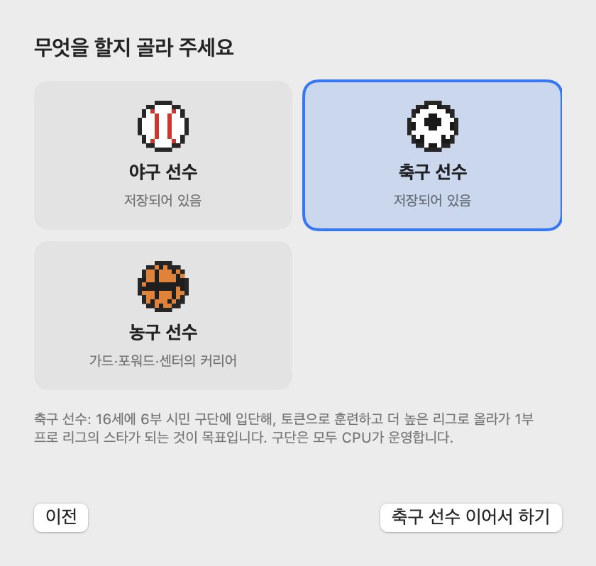
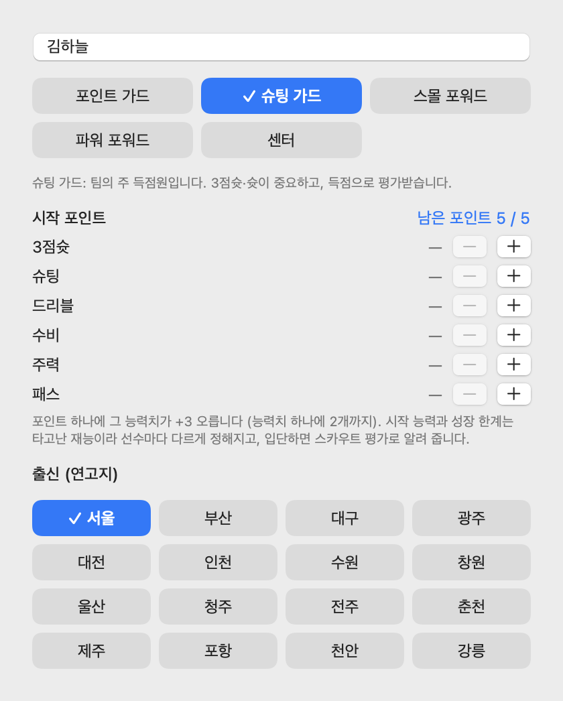
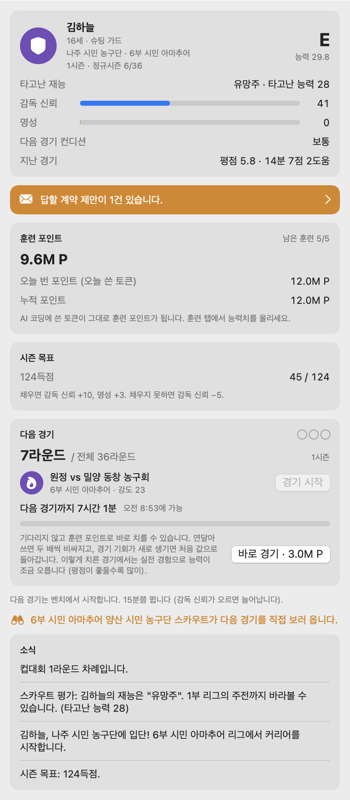
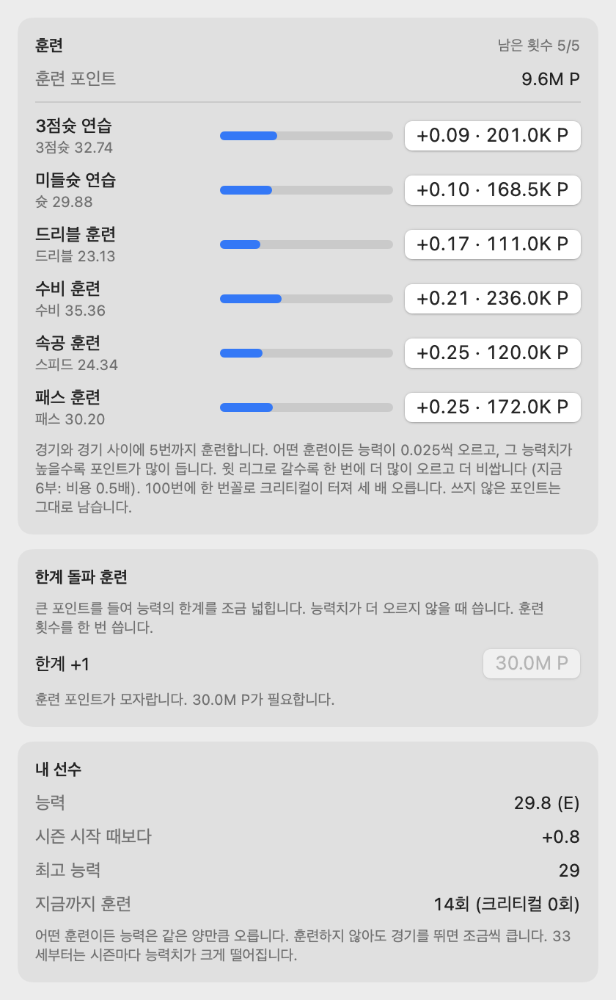
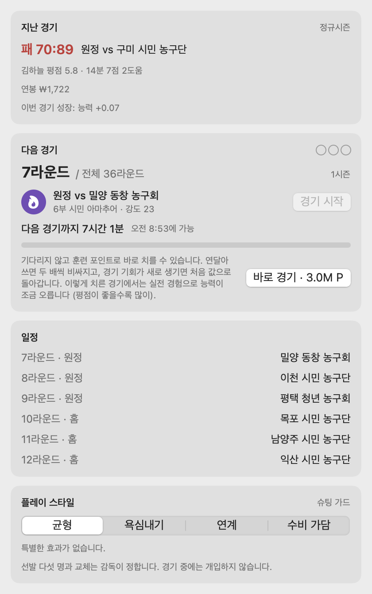
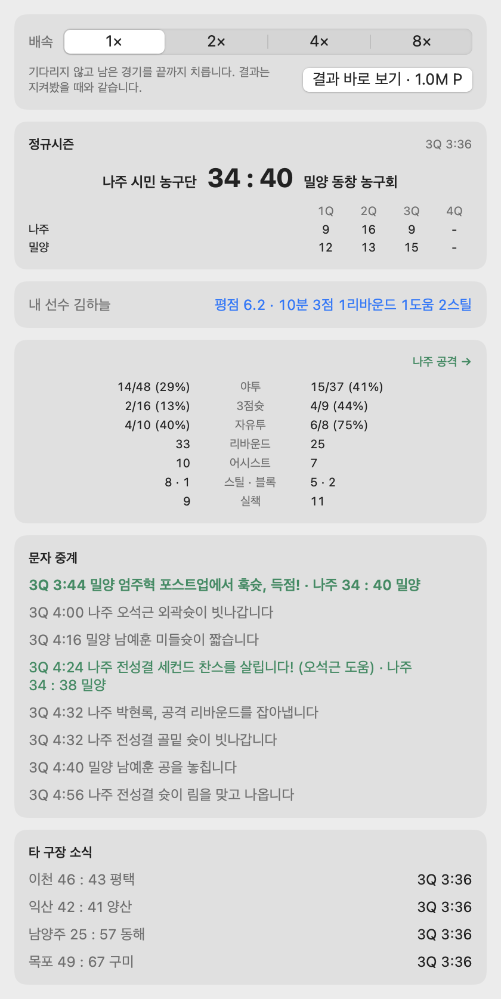
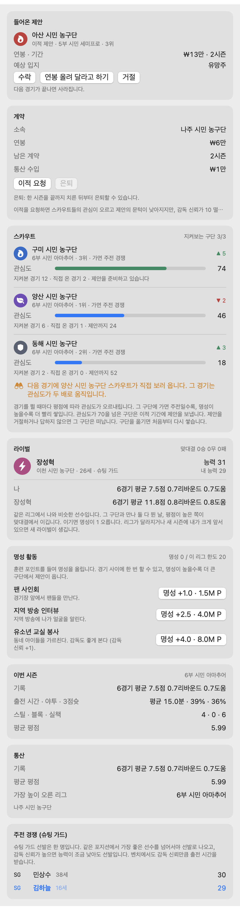

# 농구 개인 성장

**농구 선수 한 명**이 된다. 16세에 6부 시민 농구단에 입단해, 코딩하며 쓴 토큰으로 훈련하고, 선발 자리를 따내고, 더 높은 리그의 구단으로 옮겨 가며 1부 프로 리그의 스타가 되는 것이 목표다. 농구에는 구단 경영 모드가 없다.

[플레이 가이드 목록](README.md) · 규칙의 근거와 수치: [농구 선수 모드](../11-basketball.md) · 공통 틀(계약, 스카우트, 은퇴): [야구 선수 모드](../09-baseball-player-mode.md)

## 다른 종목과 무엇이 다른가

| | 야구 선수 | 축구 선수 | 농구 선수 |
|---|---|---|---|
| 매 경기 나오나 | 타자는 매 경기 선발 | 선발이 아니면 후반 교체 | **매 경기 나온다.** 선발이 아니면 벤치에서 8~24분 |
| 선발 자리 | 포지션마다 한 명 | 포메이션에 따라 1~5명 | 포지션마다 **한 명** |
| 경기 전에 정하는 것 | 없음 | 플레이 스타일 | 플레이 스타일 |
| 내 선수가 나오는 장면 | 한 경기 네댓 번 | 한 경기 몇 번 | **가장 많다.** 공격마다 공이 올 수 있다 |
| 이적 기간 | 오프시즌 + 24라운드까지 | 여름, 겨울 | 오프시즌 + 24라운드까지 |

## 시작하기

1. 처음 화면이나 설정 탭의 "모드"에서 **농구 선수**를 고른다.
2. 선수를 만든다: 이름, 포지션, 출신, 시작 포인트. **시작 포인트 5개**를 키우고 싶은 능력치에 나눠 넣는다 (포인트 하나에 +3, 능력치 하나에 2개까지). 시작 능력과 성장 한계는 타고난 재능이라 선수마다 다르고, 입단하면 홈 탭의 "타고난 재능"에 등급으로 나온다.

3. "커리어 시작"을 누르면 6부 시민 아마추어 리그의 구단에 입단한다. 나이 16세, 훈련 포인트 100,000 P.

### 어떤 포지션을 고를까

포지션은 커리어 중에 바꿀 수 없다.

| 포지션 | 능력에 중요한 것 | 시즌 목표 | 이런 사람에게 |
|---|---|---|---|
| **포인트 가드** | 패스 30% · 드리블 22% · 3점슛 15% | 어시스트 | 공을 나눠 주는 쪽. 어시스트(+0.11)가 평점을 끌어올린다 |
| **슈팅 가드** | 3점슛 28% · 슛 25% · 드리블 15% | 득점 | 점수로 평가받고 싶다. 팀의 주 득점원 |
| **스몰 포워드** | 슛 25% · 3점슛 18% · 수비 17% | 득점 | 득점과 수비를 고르게. 능력치가 가장 넓게 쓰인다 |
| **파워 포워드** | 리바운드 25% · 슛 23% · 피지컬 22% · 수비 20% | 리바운드 | 골밑 싸움. 리바운드와 득점을 같이 쌓는다 |
| **센터** | 리바운드 30% · 피지컬 25% · 수비 22% | 리바운드 | 리바운드와 블록. 더블더블(+0.3)을 노리기 쉽다 |

## 하루의 흐름

1. 평소처럼 AI 코딩을 한다. 쓴 토큰이 훈련 포인트로 쌓인다.
2. **훈련 탭**에서 훈련을 다섯 번까지 한다.
3. **경기 탭**에서 플레이 스타일을 고른다 (바꾸지 않으면 지난번 그대로다).
4. 경기 기회가 생기면 **경기 시작**을 누른다. 한 경기는 1배속으로 15분쯤이다.
5. 경기가 끝나면 평점이 나오고, 훈련 횟수가 다시 채워진다.

## 홈 탭

- **선수 카드**: 나이, 포지션, 소속 구단과 리그, 능력과 등급(F~S), 타고난 재능, 감독 신뢰, 명성, 다음 경기 컨디션, 지난 경기 평점과 기록 (뛴 시간, 득점, 리바운드, 도움).
- **주황색 알림**: 답할 계약 제안이 있을 때.
- **훈련 포인트**와 남은 훈련 횟수.
- **시즌 목표**: 득점, 리바운드, 어시스트 가운데 포지션에 맞는 것 하나. 채우면 감독 신뢰 +10, 명성 +3. 못 채우면 감독 신뢰 −5.
- **다음 경기**: 그 아래에 다음 경기에 어떻게 나오는지 한 줄로 나온다.

| 다음 경기 안내 | 뜻 |
|---|---|
| 다음 경기에 선발로 나섭니다 | 같은 포지션에서 가장 앞섰다 |
| 다음 경기는 벤치에서 시작합니다. 15분쯤 뜁니다 | 선발에서 밀렸다. 적힌 시간은 반드시 뛴다 (감독 신뢰가 오르면 늘어난다) |

스카우트가 다음 경기를 직접 보러 오면 그 아래에 주황색 줄로 나온다.

## 선발 경쟁

선발은 포지션마다 **한 명**이다. 같은 포지션에서 `내 능력 + 감독 신뢰 보정`이 가장 좋은 동료 이상이면 선발이다. 보정은 신뢰 50에서 0이고, 신뢰 100이면 +5, 신뢰 0이면 −5다.

선발이 아니어도 매 경기 나온다. 벤치에서 시작해 감독 신뢰만큼 뛴다:

| 감독 신뢰 | 0 | 20 | 40 | 60 | 90 이상 |
|---|---|---|---|---|---|
| 뛰는 시간 (40분 경기) | 8분 | 11분 | 15분 | 18분 | 24분 |

선발이면 28분 안팎을 뛴다. 지치면 감독이 잠깐 쉬게 하고, 4쿼터 마지막 3분과 연장에는 다시 올린다. 개인 반칙이 다섯 개면 물러난다.

커리어 탭의 **주전 경쟁** 카드에서 같은 포지션 선수들의 능력을 볼 수 있다. 몇 점을 넘어서야 선발인지가 보인다.

## 훈련 탭

훈련을 고르면 버튼에 적힌 만큼 그 능력치가 오르고 포인트가 든다. **어떤 훈련이든 능력(선수 카드의 숫자)은 같은 양만큼 오른다**: 6부 0.025에서 1부 0.05까지, 윗 리그일수록 많이 오르고 비용도 0.5배에서 1.4배까지 오른다. 포지션에서 덜 중요한 능력치는 한 번에 많이 오르고, 중요한 능력치는 조금씩 오른다.

| 훈련 | 오르는 능력치 | 경기에서 |
|---|---|---|
| 미들슛 연습 | 슛 | 2점슛과 자유투가 더 잘 들어간다 |
| 3점슛 연습 | 3점슛 | 3점슛이 더 잘 들어간다 |
| 패스 훈련 | 패스 | 어시스트가 는다 |
| 드리블 훈련 | 드리블 | 실책이 준다 (팀 전체와 내 실책 모두) |
| 수비 훈련 | 수비 | 스틸과 블록이 늘고, 상대 슛이 덜 들어간다 |
| 박스아웃 훈련 | 리바운드 | 리바운드를 더 잡는다 |
| 속공 훈련 | 스피드 | 상대를 압박해 실책을 끌어내고, 스틸이 는다 |
| 웨이트 트레이닝 | 피지컬 | 2점슛, 블록, 리바운드에 조금씩 보탬이 된다 |
| 셔틀런 | 체력 | 늦게 지친다. 지치면 능력이 깎이고 먼저 벤치로 간다 |

포지션마다 할 수 있는 훈련이 다르다 (그 포지션의 능력에 들어가는 능력치만).

**알아 둘 규칙** (다른 종목과 같다)

- **경기 사이에 다섯 번**까지만 훈련한다. 경기를 치르면 다시 채워진다. 쓰지 않은 포인트는 그대로 남는다.
- **크리티컬**: 1% 확률로 같은 포인트로 세 배 오른다.
- 비용은 그 능력치가 높을수록 비싸고, 훈련할 때마다 조금씩 오른다.
- **추가 훈련**: 설정 탭에서 켜면 다섯 번을 넘겨서도 훈련할 수 있다. 한 번마다 비용이 1.5배씩 더 든다.
- 타고난 **한계(잠재력)** 에 가까워지면 비용이 두 배가 되고, 닿으면 더 오르지 않는다. **한계 돌파 훈련**(1,500만 P)으로 +1 넓힌다.
- **29세까지 훈련할 수 있다.** 30~32세에는 스피드와 체력이 조금씩, 33세부터는 능력치가 본격적으로 떨어진다.
- 훈련하지 않아도 경기를 뛰면 조금씩 큰다. 경기 결과에 "이번 경기 성장: 능력 +0.07"처럼 적힌다.

### 무엇을 올릴까

- **비용**: 값이 낮은 능력치가 싸다. 같은 포인트로 훈련을 더 많이 하려면 낮은 것부터 올린다.
- **평점**: 슈팅 가드는 슛과 3점슛, 포인트 가드는 패스, 빅맨(파워 포워드·센터)은 리바운드를 올려야 그 일을 더 자주, 더 잘 한다. 놓친 슛은 −0.06이라, 성공률이 낮으면 많이 던질수록 손해다.
- **체력**: 선발인데 오래 못 뛴다면 셔틀런을 챙긴다.

## 경기 탭: 플레이 스타일

경기 전에 플레이 스타일을 하나 고른다. 선발 다섯 명과 교체는 감독이 정한다.

| 스타일 | 효과 | 대가 | 언제 |
|---|---|---|---|
| **균형** | 없음 | 없음 | 기본 |
| **욕심내기** | 슛을 1.7배 자주 던진다 | 성공률이 3%p 떨어진다. 도움과 수비 가담이 준다 | 득점 목표를 채워야 할 때, 슛이 좋은 가드·포워드 |
| **연계** | 도움 기회가 1.7배, 도움 하나의 평점이 0.11 → 0.14 | 슛이 준다 | 포인트 가드, 어시스트 목표 |
| **수비 가담** | 스틸, 블록, 리바운드에 더 자주 나선다 | 체력이 1.2배 빨리 준다 | 센터와 파워 포워드, 체력이 받쳐 줄 때 |

"지난 경기"에는 점수, 내 평점과 기록, 받은 연봉, 이번 경기 성장이 나온다.

## 중계

- 맨 위에 쿼터별 점수, 그 아래에 **내 선수 줄**(평점, 뛴 시간, 득점, 리바운드, 도움, 스틸)이 실시간으로 바뀐다.
- **코트**: 왼쪽이 우리 골대, 오른쪽이 상대 골대다. 공격하는 쪽 반코트가 밝아지고 그 골대 앞에 공이 있다.
- 그 아래에 두 팀의 기록(야투, 3점슛, 자유투, 리바운드, 어시스트, 스틸·블록, 실책)이 나란히 나오고, 어느 팀이 공격 중인지 화살표로 나온다.
- **상단바**: 평소에는 내 선수가 드리블, 점프슛, 달리기, 웨이트를 번갈아 하고, 경기 중에는 드리블한다.
- 문자 중계에서 득점 장면은 초록색, 내 선수가 나온 장면은 파란색이다.
- 득점이 워낙 잦아서 농구는 득점마다 중계를 멈추거나 알림을 보내지 않는다.
- 10분 4쿼터이고, 동점이면 5분씩 연장한다. 무승부가 없다.

### 평점

1.0~10.0이고 6.0이 "무난했다"이다.

| 한 일 | | 못한 일 | |
|---|---|---|---|
| 득점 1점 | +0.06 | 실책 | −0.15 |
| 리바운드 | +0.07 | 놓친 슛 | −0.06 |
| 어시스트 | +0.11 | 놓친 자유투 | −0.03 |
| 스틸, 블록 | +0.2 | 반칙 | −0.05 |
| 더블더블 | +0.3 | | |

- 팀이 이기면 +0.2, 지면 −0.2. 포지션마다 조금씩 빼는 보정이 있다 (−0.25 ~ −0.5).
- **짧게 뛰면 6.0 쪽으로 당겨진다** (30분 뛰어야 온전히 반영된다).
- **8.5 위로는 완만하게 오른다.** 아주 잘한 날과 역사적인 날이 구분되게 했다.
- 리그 평균 수준으로 벤치에서 15분 뛰면 평점 6.0 안팎, 리그 상위 수준의 선발이면 6.3~6.7이다. 6점대 초반이 보통이니 실망하지 않아도 된다.

### 감독 신뢰와 명성

| | 오르는 때 | 내리는 때 |
|---|---|---|
| **감독 신뢰** | 평점 7.0 이상, 시즌 목표 달성 (+10), 훈련 (조금) | 평점 6.0 미만, 시즌 목표 실패 (−5), 이적 요청 (−10) |
| **명성** | 평점 6.3을 넘긴 경기 (넘긴 만큼 두 배로), 수상, 시즌 목표 달성 | 시즌이 바뀔 때 10% |

- **20분 미만으로 뛴 경기**는 신뢰가 조금만 움직인다: 평점 6.5 이상이면 +0.5, 5.7 미만이면 −0.5. 벤치에서 한 시즌을 보내도 재계약 기준(30) 아래로 떨어지지 않는다.
- 감독 신뢰가 **30 아래면** 계약이 끝날 때 재계약 제안을 받지 못한다.
- 구단을 옮기면 감독 신뢰는 40에서 다시 시작한다.

### 컨디션, 기세, 연속 기록, 라이벌

- **컨디션**과 **기세**는 다른 종목과 같다 → [축구 개인 성장](football-player.md#컨디션-기세-연속-기록).
- **연속 기록**은 "연속 두 자릿수 득점" 경기를 센다.
- **라이벌**은 같은 리그의 다른 구단에서 뛰는 같은 포지션 선수다. 커리어 탭의 "라이벌" 카드에서 경기당 기록을 나란히 본다. 둘 다 뛴 맞대결에서 평점이 높은 쪽이 이기고, 이기면 명성이 1 오른다.

### 컵대회

리그와 별개로 60개 구단이 모두 나오는 단판 승부 대회가 시즌마다 여섯 라운드 열린다. 윗 리그 구단을 잡으면 명성이 크게 오른다. 규칙은 축구와 같다 → [축구 개인 성장](football-player.md#컵대회).

## 커리어 탭

- **들어온 제안**: 구단, 리그와 순위, 연봉과 기간, 예상 입지(주전 / 주전 경쟁 / 유망주). 수락 / 연봉 올려 달라고 하기 / 거절. 이적 제안은 다음 경기가 끝나면 사라진다.
- **계약**: 소속, 연봉, 남은 계약, 통산 수입, 이적 요청, 은퇴.
- **스카우트**: 나를 지켜보는 구단(세 곳까지)과 관심도. 관심도가 70을 넘은 구단이 이적 기간에 제안한다. 스카우트가 직접 보러 오는 경기는 관심도가 두 배로 움직인다. 평점 6.0을 기준으로 오르내린다.
- **라이벌**, **명성 활동** (팬 사인회, 지역 방송 인터뷰, 유소년 교실 봉사).
- **이번 시즌 · 통산**: 경기당 득점·리바운드·도움, 출전 시간, 야투·3점슛 성공률, 스틸·블록·실책, 평균 평점.
- **주전 경쟁**: 같은 포지션 선수들의 능력. 선발은 한 명이다.

### 이적 기간과 시상

- **이적 기간**은 오프시즌(친선 5경기)과 정규시즌 24라운드까지다. 이 기간에만 제안이 온다. 이적 요청을 하면 제안이 더 자주 오지만 감독 신뢰가 10 떨어진다.
- 시즌 도중에 이적하면 시즌 기록이 구단마다 따로 남는다.
- **시상**: MVP, 득점왕, 리바운드왕, 어시스트왕. 시즌의 절반 이상 뛴 선수만 받는다. 리그 탭의 기록 순위는 득점, 리바운드, 어시스트, 스틸, 블록, 3점슛 모두 경기당 평균이다.

### 리그와 승강

리그마다 10팀이 36라운드를 치르고, 순위는 승률로 정한다. 승강은 야구 방식이다: 1위 자동 승격, 2·3위 와일드카드, 승자와 윗 리그 9위의 3전 2선승, 10위 자동 강등 → [리그](../03-league.md#승강). 구단이 플레이오프에 나가면 그 경기에도 출전한다.

### 나이와 은퇴

| 훈련할 수 있는 나이 | 스피드·체력이 조금씩 떨어지는 나이 | 본격적으로 하락 | 반드시 은퇴 |
|---|---|---|---|
| 29세까지 | 30~32세 | 33세부터 | 38세 |

"은퇴" 버튼은 한 시즌을 끝까지 치른 뒤부터, 오프시즌에 누를 수 있다. 은퇴하면 커리어 기록이 **명예의 전당**에 남고, 같은 세계에서 새 선수를 만들어 다시 시작한다.

## 키우는 요령

1. **처음에는 벤치에서 15분쯤 뛴다.** 평점 6.5를 넘기면 신뢰가 조금씩 오르고, 뛰는 시간이 늘어난다. 같은 포지션의 선발 한 명만 넘으면 된다.
2. **놓친 슛은 감점이다.** 욕심내기는 슛 성공률이 받쳐 줄 때만 쓴다.
3. **빅맨은 리바운드부터.** 리바운드는 하나에 +0.07이고 자주 나와서, 평점과 시즌 목표가 같이 오른다. 득점, 리바운드, 어시스트, 스틸, 블록 가운데 두 가지가 두 자릿수면 더블더블 +0.3.
4. **포인트 가드는 연계.** 도움 하나가 0.14가 되고 어시스트 목표가 빨리 찬다.
5. **수비 가담은 체력이 받쳐 줄 때만.** 스틸·블록은 하나에 +0.2로 크지만 체력이 빨리 준다.
6. **윗 리그로 너무 일찍 가지 않는다.** 예상 입지가 "유망주"면 계속 벤치에서 시작한다. 주전 경쟁 카드로 내 위치를 먼저 본다.
7. 포인트가 계속 남거나 계속 모자라면 설정 탭의 **가격 난이도**로 훈련 비용을 조절한다.

## 아직 없는 것

농구 구단 경영 모드, 작전(지역 방어, 속공 등), 팀 반칙 보너스와 공격 반칙, 부상, 올스타전은 아직 없다.
